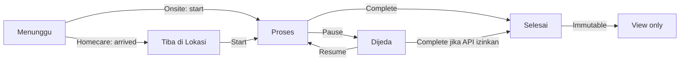

# MOMNJO THERAPIST — UI DESIGN SYSTEM
**Version:** v1.0 draft • 30 Oktober 2026 • Platform: mobile app • Locale: Bahasa Indonesia • Source: 11 papan mockup yang diberikan pengguna.

> **Batas acuan:** Panduan ini diturunkan dari mockup, *bukan* ekstraksi token merek resmi dan *bukan* bukti kontrak API. Warna adalah estimasi dari screenshot. Perilaku yang disebut "API v4" berasal dari revisi visual yang tertera pada mockup; field/response final tetap perlu diuji terhadap dokumentasi atau OpenAPI.

## 01 — Prinsip
1. **Tindakan terpenting mudah dijangkau.** Satu CTA utama per screen; alur kerja berada di area bawah yang dapat disentuh ibu jari.
2. **Status dari server = sumber kebenaran.** Label, timer, dan enable/disable kontrol berpatokan pada status hasil API terakhir; optimistik hanya ketika aman dan bisa rollback.
3. **Informasi penting konsisten.** Nama treatment, customer, no. transaksi, jenis Homecare/Onsite, durasi, dan status muncul dalam urutan yang sama.
4. **Error tetap actionable.** Beri pesan yang jelas dan CTA retry/login/list job sesuai jenis error. Jangan lanjutkan status otomatis saat API gagal.
5. **Perawatan → aksesibilitas.** Kontras isi, touch target, izin gerakan, dan label icon diperhatikan.

## 02 — Foundations
### Warna semantik (estimasi)
| Token | HEX | Penggunaan |
|---|---|---|
| `brand.500` | `#AD3B64` | primary CTA, active tab, icon brand |
| `brand.600` | `#A63762` | CTA gradient, active ink accent |
| `brand.700` | `#8B2349` | pressed, dark brand text |
| `brand.100` | `#F7DFE8` | active tint, rose chips |
| `ink.strong` | `#111B3C` | judul dan angka penting |
| `ink.muted` | `#64708A` | label sekunder |
| `surface.canvas` | `#FFFAFA` | background screen |
| `surface.card` | `#FFFFFF` | surface card dan dialog |
| `surface.border` | `#E5E8EF` | divider dan outline |
| `feedback.success` | `#19865C` | berhasil, check-in, selesai |
| `feedback.warning` | `#B95A08` | peringatan, menunggu, jeda |
| `feedback.danger` | `#D52F46` | invalid form, HTTP error |
| `feedback.info` | `#3159A2` | edukasi, informasi |

**Jangan pakai warna saja sebagai pembeda status**: tuliskan label, icon, dan bila perlu keterangan.

### Typography
UI font disarankan **Inter** atau **Plus Jakarta Sans** (belum ada font brand resmi yang dapat diverifikasi). Scale: display 36 / H1 24 / H2 18 / body 16 / support 14 / caption 12 px. Weights: 400/500/600/700. Nominal uang gunakan tabular numbers; timer gunakan tabular + monospaced digits. Maksimal 2 baris pada judul pekerjaan sebelum truncation; full title dapat dilihat di detail.

### Layout & ruang
- Frame dasar desain: **390 × 844 dp** (responsive untuk 360–430 dp; jangan hardcode tinggi).
- Safe area system dan keyboard harus diakomodasi; bottom fixed CTA tidak menutup content.
- Horizontal margin mobile: **16 px**; jarak card: **12 px**; padding card: **16 px**.
- 8pt spacing baseline (tersedia 4pt untuk micro-adjustment): 4/8/12/16/20/24/32/40/48.
- Radius input **12**, card **16**, modal **24**, chip **999** px.
- Touch target minimal **44×44**; button/form control umumnya **48** px.
- Drop shadow halus, hindari shadow berlapis pada card bertumpuk.

## 03 — Component Library
| Komponen | Varian wajib | State wajib |
|---|---|---|
| `AppHeader` | simple back, title+subtitle, home header | default |
| `BottomNavigation` | Beranda, Job, Laporan, Profil | active, idle |
| `Button` | primary, secondary outline, tertiary/text, danger | default, pressed, disabled, loading |
| `TextField` | text, email, phone, password, numeric, textarea | default, focus, filled, invalid, readonly, disabled |
| `Select/DateFilter` | select, date range, branch | default, chosen, invalid, disabled |
| `JobCard` | Homecare, Onsite | Menunggu, Arrived, Proses, Dijeda, Selesai, Closed |
| `StatusChip` | job, attendance, category, fee type | all domain statuses |
| `InfoCard / DetailRow` | customer, treatment, address, transaction | default, empty |
| `TreatmentTimer` | running, paused, completed | syncing, server rejected, offline |
| `AttendanceCard` | Off Duty, On Duty | submitting, request denied |
| `CommissionSummary` | total, regular, redeem, override | loading, empty |
| `Alert` | info, success, warning, danger | inline, dismissible |
| `Dialog/BottomSheet` | confirm, blocking, success | open, retrying |
| `EmptyState` | jobs, report, attendance, search | empty |
| `Skeleton` | detail, list, report | loading |
| `InlineLink` | WhatsApp, maps, phone, details | available, unavailable |

### Buttons
- `primary`: fill/gradient brand + white text; **hanya satu CTA utama** per tindakan utama.
- `secondary`: white + 1px brand border + brand text.
- `danger`: digunakan untuk destructive/irreversible action, bukan pengganti semua CTA merah muda.
- `disabled`: grey, tidak menerima input dan memiliki penjelasan kondisi bila relevan.
- `loading`: teks dipertahankan + spinner, cegah double submit; loading tidak mengubah status sebelum API success.

### Inputs
- Label selalu ditampilkan di atas input; placeholder bukan satu-satunya label.
- Validasi inline setelah blur/submit (bukan error sejak awal tanpa interaksi).
- Error field punya border merah, icon, teks alasan terukur.
- Angka tekanan darah `sistolik / diastolik` mmHg; suhu tubuh °C; hindari asumsi threshold medis tanpa API/aturan produk.
- Edit profil: nama lengkap, nama panggilan, email, nomor telepon, alamat editable sesuai API v4 pada revisi. Username, gerai/branch ID, level akun, blocked status **read-only**.
- Password lama + password baru, minimum **6 karakter**; konfirmasi password frontend; jangan log/telemetry nilai password.

## 04 — Status pekerjaan & transisi
**Label UI usulan** disatukan dari mockup; validasi mapping status literal terhadap response API v4 sebelum implementasi.

`Closed` adalah status transaksi administratif yang **tidak otomatis men-disable Mulai Treatment** bila API/job status tetap memperbolehkan operasi, sesuai mockup revisi. Jangan menggabungkan transaction status dengan treatment status menjadi satu enum.

- **Homecare arrival:** konfirmasi tiba hanya memakai job ID, action, optional notes; **foto bukan syarat**. Boleh akses maps jika tersedia.
- **Onsite:** tidak memakai tombol Tiba di Lokasi.
- **Assessment:** optional sebelum/selama treatment, field `Tekanan Darah`, `Suhu Tubuh`, `Keluhan`, `Alergi`, `Catatan Khusus`.
- **Timer:** sisa waktu dan waktu berjalan hasil kalkulasi dari server timestamps/duration/pause state; refresh setelah mutasi, foregrounding, reconnect, dan reject 400. Jangan jadikan counter frontend sumber kebenaran.
- **Duplicate start/pause/resume/complete:** tampilkan state aktual terbaru + jelaskan mengapa aksi ditolak; tombol disesuaikan dengan state terbaru, jangan retry secara buta.

## 05 — Screen inventory
### Auth & account
Login, loading login, missing credentials (422), wrong credentials (401), blocked/deactivated (403), session expired (401), Logout Confirmation.

### Beranda & absensi
Off Duty, Check-in confirmation, On Duty, Already On Duty (400), Already Off Duty (400), Riwayat Absensi, Riwayat Kosong, Auto Check-out Info.

### Job & workflow
Job List (Aktif/Selesai/Semua), Job Detail Homecare/Onsite, Homecare Arrival, Medical Assessment, Treatment Running, Treatment Paused, Completed, Closed transaction case, invalid arrived (400), invalid transition (400), reassigned/not found (404), network error, server error (500).

### Report & komisi
Dashboard komisi, date/branch filter, rincian pengerjaan, detail redeem, komisi override, detail override, laporan kosong, skeleton/loading, error banner.

### Profil & support
Profile, Edit Profile, Password Change, Branch Contact (WhatsApp only if returned by API), contact unavailable (404), validation error (422), success confirmation, password mismatch frontend.

## 06 — Error handling and interaction rules
| Kode/kondisi | Visual | Tindakan |
|---|---|---|
| Invalid local form | red inline field + supporting text | fokus ke field pertama yang error |
| 400 Invalid job transition | warning/info banner or modal | refresh data job, render tombol sesuai status terbaru |
| 401 wrong credentials | form-level error | koreksi login, jangan hapus username tanpa alasan |
| 401 expired session | blocking bottom sheet | `Masuk Kembali`; clear auth/session securely |
| 403 blocked/deactivated | blocking modal | disable protected action, admin contact kalau tersedia |
| 404 job reassigned/not found | blocking modal | `Kembali ke Daftar Job`, refresh list |
| 404 branch WA unavailable | contact unavailable sheet | disable WA button, opsi kembali/admin pusat sesuai produk |
| 422 validation | inline per-field and/or form-level error | pertahankan data yang valid, fokus ke invalid |
| 500 internal error | full-page/inline retry state | `Coba Lagi`, jangan submit aksi non-idempotent tanpa cek status |
| Offline | full-page/inline disconnected state | `Coba Lagi`, label data belum tentu terbaru |
| Empty, bukan error | empty illustration, deskripsi, optional filter action | jangan gunakan red danger component |

**Feedback:** Toast 3–5s untuk nonblocking success/info; banner persisten untuk problem kontekstual; dialog/sheet untuk sesi habis, ownership job, akun blocked, dan keputusan destruktif. Semua pesan dalam Bahasa Indonesia sederhana.

## 07 — Visual & accessibility QA
- Body text ≥ 14px untuk content utama di mobile, caption 12px hanya untuk informasi bukan kritikal.
- Target WCAG AA: 4.5:1 untuk teks normal, 3:1 untuk icon/large text. Ukur terhadap kombinasi foreground/background aktual, termasuk gradient.
- Tab bar empat item: icon + label; warna active disertai bold; top-level back selalu dapat diakses.
- Input dapat dibaca saat keyboard terbuka; preserve scroll/focus/validation errors.
- Timer menggunakan digit tabular agar angka tidak melompat saat berubah; respect reduced motion.
- Skeleton mengikuti bentuk konten final dan berhenti pada success/error; jangan infinite loading loop.
- Jangan memakai warna saja untuk membedakan commission positive/negative: pakai +/- dan teks Masuk/Keluar.
- Navigasi WA eksternal hanya bila link/phone valid dan dikembalikan oleh API.

## 08 — Implementation handoff
Disarankan struktur UI: `foundations/`, `components/{actions,forms,navigation,feedback,job,timer,reports}`, `patterns/{auth,attendance,treatment,commission,profile}`, `screens/`, `api-adapters/` (status/error normalization), dan `test/` untuk state matrix. Pengembangan API adapter harus menguji raw response field/status pada API v4, termasuk error per endpoint. Gunakan `tokens.css` atau `tokens.json` sebagai source definisi warna/space; gunakan semantik `--success`, bukan hard-code warna di screen.

### Keputusan final yang wajib dipegang
- Foto kedatangan **tidak wajib**.
- Form asesmen **optional** dan memakai 5 bidang versi revisi.
- `Alamat` editable; field identitas/otorisasi akun protected.
- Password minimal **6** karakter, konfirmasi di frontend.
- Hubungi Admin Gerai memakai **nomor WhatsApp dari API**, tidak dibuat-buat.
- `Closed` transaksi tidak otomatis menonaktifkan aksi treatment.
- Timer/server state tidak boleh disimpulkan dari jam perangkat semata.
